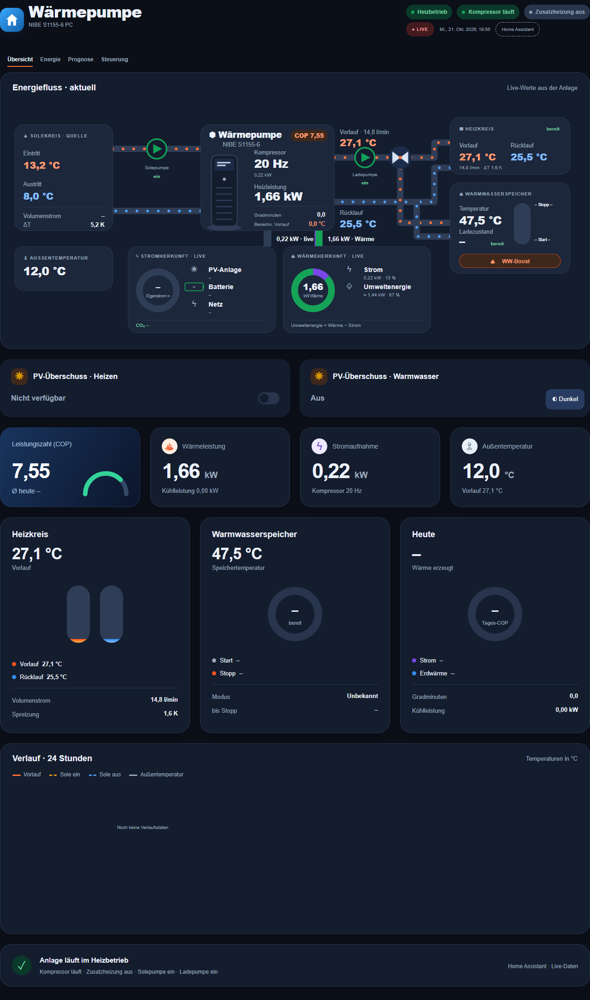

# NIBE Flow Dashboard

**Die Wärmepumpe im Blick: animierte Kreisläufe, klare Messwerte und eine eigene Home-Assistant-App.**

[](https://my.home-assistant.io/redirect/supervisor_add_addon_repository/?repository_url=https%3A%2F%2Fgithub.com%2FOniel10%2Fnibe-flow-dashboard)

**HA-App 0.1.1 · Frontend 0.5.1 · MIT · Deutsch · experimentell**



[Mobil dunkel](docs/images/app-demo-390-dark.png) · [Desktop dunkel](docs/images/app-demo-1280-dark.png) · [Installation und Konfiguration](nibe_flow/DOCS.md)

## Funktionen

- Eigenständige HA-App mit Ingress, HA-Anmeldung und eigenem Seitenleisteneintrag.
- Animiertes Schema für Solekreis, Wärmepumpe, Heizkreis, Warmwasser und passive Kühlung.
- Eigene mobile Darstellung; Hell, Dunkel und automatischer Farbmodus.
- Übersicht, Steuerung, Energie und Prognose in einer Oberfläche.
- Einzelne Änderungen vormerken und speichern; „Vorher“ erscheint nur bei offenen Änderungen.
- Plus/Minus neben Schiebereglern, native Grenzen und Schrittweiten, Gradminuten −400 bis +100.
- WW-Boost direkt im Warmwasserfeld oder auf der Steuerungsseite starten und beenden.
- Energieauswertung mit Tag, Woche, Monat, Jahr und Navigation durch vergangene Zeiträume.
- Live-Stromherkunft, Batterie-Ladestand und geschätzter CO₂-Mix bei zugeordneten Quellen.
- EEDC-Tagesprognose mit Datumswahl und geschätzter WP-Stromherkunft; andere Verbraucher haben Vorrang bei PV und Akku.
- Verlauf beim Anklicken eines zugeordneten Live-Wertes.

Die App spricht mit vorhandenen Home-Assistant-Entitäten. Sie ersetzt weder die NIBE-Integration noch eine Modbus-Anbindung und legt keine unbekannten Register an.

## Installation

Voraussetzung: Home Assistant OS/Supervisor, vorhandene NIBE-Entitäten und eine konfigurierte NIBE-Flow-Karte. Die App importiert deren Zuordnungen lesend aus dem gewählten Dashboard. Der Dashboard-Pfad wird bei der Einrichtung passend zu deiner Installation gewählt. Neue Nutzer richten zuerst die [Entitätszuordnung](docs/card.md) ein.

1. Den Installationsknopf oben verwenden oder `https://github.com/Oniel10/nibe-flow-dashboard` unter **Einstellungen → Apps → App installieren → ⋮ → Repositories** hinzufügen.
2. **NIBE Flow** installieren und starten.
3. **Weboberfläche öffnen** wählen und bei Bedarf **In Seitenleiste anzeigen** aktivieren.
4. Dashboard und EEDC-App-ID in der App-Konfiguration kontrollieren.

Steuerungen sind zunächst ausgeschaltet (`enable_controls: false`). Wenn alle Zuordnungen geprüft sind, können sie in der App-Konfiguration eingeschaltet werden. Speichern schreibt anschließend ausschließlich die ausgewählte Änderung. Für die App ist ein HA-Administrator erforderlich.

Die Installation baut das Container-Image auf deinem HA-System. Internet wird zum Herunterladen und Bauen benötigt; die HA-/EEDC-Kommunikation zur Laufzeit bleibt lokal. Es werden keine Host-Ports geöffnet und keine Zugangstokens in den Browser übertragen.

## Aussage und Grenzen

- WP-Prognose: historisches Muster aus bis zu 30 Tagen EEDC-Rohdaten, keine zusätzliche Wetterkorrektur. Haus-, PV- und Akku-Prognosen kommen direkt aus EEDC. Details stehen in [Prognose und Stromherkunft](docs/forecast.md).
- Akku-Tagesvorschau: historische Mitternachts-Ladestände als Startannahme, kein bis zum Zieldatum fortgeschriebener Live-Ladestand.
- Wärme, COP, Stromherkunft und CO₂ sind nur mit passenden Entitäten verfügbar. Fehlende oder widersprüchliche Daten werden nicht als null dargestellt.
- WW-Boost benötigt eine geprüfte Zuordnung von Register 40698. Die Voreinstellung 2 = einmalige Erhöhung und 0 = aus wurde an einer S1155 geprüft; bei anderer Firmware zuvor die tatsächlichen Registerwerte prüfen. [Details](nibe_flow/DOCS.md#ww-boost).
- Die eigenständige App wurde lokal mit simulierten HA-Antworten und automatisierten Tests geprüft. Ein Container-Start auf echter HA-Hardware ist noch nicht verifiziert. amd64 und aarch64 sind konfiguriert; Hardware-Kompatibilität ist noch zu bestätigen.

Alle veröffentlichten Vorschaubilder verwenden **synthetische Werte**. Es werden keine persönlichen HA-Konfigurationen oder historischen Messdaten mitgeliefert.

## Entwicklung

```sh
npm run check
python -m pip install -r nibe_flow/requirements.txt
python -m unittest discover -s nibe_flow/tests -v
```

Browser-Probe:

```sh
npm install --no-save playwright@1.64.1
npx playwright install chromium
node scripts/check-app.mjs
```

`src/` enthält die gemeinsame Oberfläche; `dist/` die optionale Lovelace-Karte; `nibe_flow/` die HA-App mit Server und erzeugtem Frontend. `scripts/build-app.mjs` übernimmt die zusätzlichen Steuerungen aus `src/controls-v2.js` mit eindeutigen Build-Prüfungen. Die App benötigt zur Laufzeit keine Lovelace-Ressourcen.

[Sicherheit](SECURITY.md) · [Mitwirken](CONTRIBUTING.md) · [MIT-Lizenz](LICENSE)
